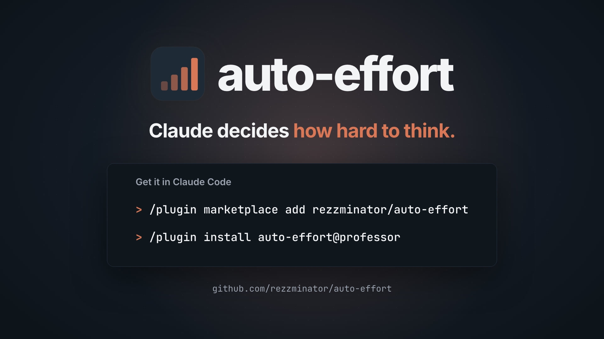

<div align="center">

# auto-effort

**Claude sets its own reasoning effort. The Claude Code main chat gets a `set_effort` tool: the model raises its effort when the work turns hard and lowers it when only mechanical steps remain. A sub-agent's effort is set per spawn, and an agent that opts in steps its own effort with its trouble.**

[](https://docs.claude.com/en/docs/claude-code/plugins)
[](./CHANGELOG.md)
[](./LICENSE)

</div>

[](media/auto-effort.mp4)

<p align="center">▶ <a href="media/auto-effort.mp4">Watch the 21-second demo</a></p>

## The model picks its effort

`/effort` is one level for the whole session: a rename, a bug hunt and a cache design all run at it. With this plugin the main chat has a tool, `set_effort`, and decides the level itself, turn by turn:

```text
set_effort({ level: "xhigh", reason: "root cause not found after two fixes" })
→ Effort set to xhigh from your next request; it holds until this turn ends, or until you call set_effort with auto.
```

The tool is always loaded, never deferred behind tool search. Its description is the model's guide, one line per level between `floor` and `ceiling` (the floor's line also covers the lighter work, the ceiling's the heavier):

| Level | Work the guide places there |
| --- | --- |
| `low` | lookups, status reports, formatting, one-line edits |
| `medium` | edits whose every line the plan already fixes (a rename, a move, a known fix), running and reading tests |
| `high` | debugging a known symptom, writing non-trivial code from scratch, explaining unfamiliar code |
| `xhigh` | a decision others will build on (architecture, design trade-offs, a spec, a review verdict), or a root cause one attempt did not find |
| `max` | what xhigh already failed to settle |

It ends with when to move: *"Raise it the moment the work turns harder than planned: a test fails for a reason you cannot name, or a fix you were sure of did not hold. Lower it once only mechanical steps remain."*

- **Arguments.** `level` (a level within the range, or `auto`; `effort` is the same field) and `reason`, a few words that go to the state file and the decision log.
- **Lifetime.** A level applies from the next request until the turn ends, over the planned level and the test rules. The next turn starts at its planned level again. `auto` drops the model's level and hands the rest of the turn back to the automatic rules.
- **Inside a turn.** Claude Code moves a running turn to a new level only behind a user message that holds text, so a change after a tool result alone would wait for the next prompt. After a change inside a turn (`set_effort`, a failing-test rise, a passing run's return) the plugin appends one short line behind that tool result, `auto-effort: effort is {level} from this request on.`, which the model reads and the person does not see as typed; the next request then goes at the new level.
- **What outranks it.** Your `/effort` pin, `/auto-effort off`, a model the gate leaves alone and a model that takes no effort level. In each case the call is refused and the answer says why. A sub-agent's call is refused: `set_effort` is the main chat's.

## Quick start

The plugin is a function-hooks module; turn function hooks on first:

```bash
export CLAUDE_CODE_ENABLE_FUNCTION_HOOKS=1
```

Install it inside Claude Code. This repository is its own marketplace, named `professor`:

```text
/plugin marketplace add rezzminator/auto-effort
/plugin install auto-effort@professor
```

Start a chat and run `/auto-effort status`. Each turn starts at `high`; the model moves it from there. Sub-agent tags need no setup: the Agent tool's description tells the model about them. Live control stays off until an agent definition asks for it ([Live control](#live-control)). To remove the plugin:

```bash
claude plugin uninstall auto-effort@professor
```

It is built against the plugin API of Claude Code 2.1.296 (`types/claude-code.d.ts`).

## A main-chat turn

1. **The planned level.** The turn's first request runs at `planLevel` (`high`). A prompt longer than `planUpshiftChars` (1500 characters) or matching one of `planUpshiftPatterns` (none by default) starts at `xhigh` instead, when `planLevel` is below it.
2. **The reminder.** With `turnReminder` on, the prompt carries one line:

   ```text
   Your reasoning effort starts this turn at high, and this first response runs at high. Call set_effort first, with the level the work ahead needs; a level you set lasts until this turn ends. With no call, the turn stays at high.
   ```

   A length or pattern upshift adds why (`because the prompt is long (2210 characters)`). When the prompt matches `hintPatterns` (design, architecture, trade-offs, root causes, specs, "think hard", ultrathink), the line names up to three matched words and the guide's level for that work, held within the range, and leaves the call to the model. Hints never move the planned level.
3. **The model's call.** `set_effort` sets the level for the rest of the turn ([above](#the-model-picks-its-effort)).
4. **Failing tests raise it.** A call of a `failureTools` tool (`Bash`) whose command matches `testCommandPatterns` is a test run; its result fails when it matches `failurePatterns` and passes otherwise. A run sent to the background counts nothing. After `escalateAfterFailures` (2) failing runs in a row, the level rises one step, up to the ceiling, and the result carries one line:

   ```text
   auto-effort: 2 failing test runs this turn, so your reasoning effort rises from high to xhigh for the requests that follow.
   ```

   The count then starts again. While the model's own level holds, nothing rises: the line says the level stays and that `set_effort` with a higher level or `auto` changes that.
5. **Passing tests bring it back.** A passing run sets the count to 0. With `lowerOnPass`, the first passing run after a rise returns the level to where the failing streak found it, unless the model called `set_effort` since, and says so in one line.
6. **The clamp.** Every level the plugin sends is held within `floor` (`medium`) and `ceiling` (`xhigh`). A request's `effort` is rewritten only when it differs from the level held.

### Your `/effort`

With `userEffortPins` on, `/effort <level>` pins the session: the plugin stops steering, `set_effort` is refused, and the state file shows `pin`. `/effort auto` or `/auto-effort on` releases the pin. The pin survives `/clear`. Bare `/effort` opens Claude Code's picker; its choice is inferred from a change in the effort the next turn carries on the same model, as a `via: carried` pin, so choosing the level already in effect cannot be seen. With `userEffortPins` off, the plugin steers whatever you set.

### The model gate

`models` names each main-chat model `allow`, `probation` or `deny`; `unknownModels` covers the rest (`off`: untouched). The plugin steers `allow` and `probation` models. A `probation` model graduates to `allow` after `probationSwitches` (5) effort switches that keep the cache. A `deny` or `off` model passes through untouched, and so does a model whose request carries no effort level or a number.

### The cache check

Changing effort mid-turn must not cost the prompt cache. After each switch, the switched request must read from the cache at least `canaryThreshold` (0.9) of what the previous request cached (its cache reads plus cache writes). Below that, the plugin marks the model unsafe, stops changing effort on it, writes one warning to `warnings.jsonl` and remembers the mark across sessions. A mark is no final verdict: after an hour the model is steered again and its next switch is the recheck. A switch that keeps the cache lifts the mark; one that fails again doubles the wait, up to a day. `/auto-effort status` shows when the next check is due, and `/auto-effort clear <model>` lifts a mark at once. A chat trusts its own checks over another chat's mark, because a failure can come from one chat alone, its process or its conversation: a chat whose own switch kept the cache stays steered through a mark another chat stored and lifts it at its next clean switch, while the chat whose check failed waits out its own mark even after that. A mark holds for the context window it was found on: one on `claude-opus-5-5[1m]` leaves `claude-opus-5-5` steered, and the other way round, because one model's windows can carry effort differently in a request. The check judges nothing when it cannot hold: no token usage, a different model or context window, a compaction in between, fewer messages than before, more than `cacheTtlSeconds` (300) between the two requests, or nothing cached before.

## Sub-agents

A sub-agent's effort comes from three things, in this order: its spawn tag, its definition, and, for a steered agent, its own trouble.

### The tag

```text
Agent({
  subagent_type: "general-purpose",
  prompt: "[effort: low]\nList every file under src/ that imports lodash."
})
```

Make `[effort: low|medium|high|xhigh|max]` the first non-blank text of the Agent prompt, on one line. The tag is removed before the sub-agent reads its prompt, and its own model requests run at that level. The plugin appends the tag's usage to the Agent tool's description, so the model knows it.

- Only the prompt's first non-blank text, on one line, is a tag. `[effort: high]` later in the prompt is prose, and a markdown link `[effort: high](…)` is not a tag.
- Levels are case-insensitive. An unknown level refuses the spawn, and the model reads why. A prompt that is only a tag is refused.
- A tag beats the definition's `effort:` (`parentTag: honor`). A steered agent starts at the tag held within its floor and ceiling. `parentTag: ignore`, as the option or per type as `effortControl.parentTag`, keeps the definition's `effort:`: the tag is stripped and ignored, and a `tag-ignored` row is logged. A definition with no `effort:` still runs at the tag. A malformed tag still refuses the spawn.

### Pins

- Every sub-agent is pinned at spawn. An agent that is not steered runs at its pin; a steered one runs at its live-control level ([Live control](#live-control)). A tagged one is pinned at its tag (under `parentTag: ignore`, at its definition's effort). An untagged one runs at the effort its first request carries (its definition's `effort:`, else the session's), so a mid-run `/effort` never reaches a sub-agent already working.
- A pin lasts until the sub-agent finishes. A continuation (SendMessage) is pinned afresh at its own first request.
- Claude Code holds the pins, so they survive a plugin reload. Steering state lives in memory: a reload ends it, and the agent goes on at its pin.
- Two requests made on a sub-agent's behalf are not pinned: its compaction forks, and the short progress-line request Claude Code sends for a background sub-agent, which passes through no plugin hook.

### Live control

An agent definition turns it on with `effortControl`. Bare, `effortControl: on` (also `true` or `yes`; `off`, `false`, `no`) uses the option defaults. Nested, one level, it sets the agent's own range and rules:

```markdown
---
name: lead
description: Coordinates a build across builder and lander sub-agents.
effort: medium
effortControl:
  floor: medium
  ceiling: xhigh
  landing: lander, reviewer
  judge: on
---
You coordinate the build. Spawn builders, check their returns, run the tests, then hand off to the lander.
```

| Key | Meaning |
| --- | --- |
| `effortControl.floor`, `effortControl.ceiling` | The range of levels the agent is ever sent (default: the options). |
| `effortControl.landing` | Agent types, separated by spaces or commas or given as a YAML list (`- lander` lines): spawning one lowers the agent one step below its home level. |
| `effortControl.judge` | `on` or `off`: ask the judge at a tripwire, or raise one step mechanically (default: the option). |
| `effortControl.tripwires` | The armed tripwires, comma-separated or a YAML list (`fail1`, `fail2`, `red`, `redispatch`; empty arms none), such as `red, redispatch` for an agent that writes its tests first (default: the option). |
| `effortControl.struggleDecay` | Requests without a new tripwire after which a raised level comes home; `0` turns it off (default: the option). |
| `effortControl.parentTag` | `honor` or `ignore`: whether a tag beats this type's `effort:` (default: the option). Read even when steering is off, and it alone never turns steering on: `effortControl:` holding only `parentTag: ignore` pins a type at its own `effort:` without steering it. |
| `effortControl.enabled` | `on` or `off`; on by default when any nested key other than `parentTag` is present. |

An invalid value is logged and the default used. An agent without `effortControl`, or with it off, is not steered; only the tag rules apply to it. Definitions are read from `.claude/agents` of the project, of `CLAUDE_CONFIG_DIR` and of the home directory, then from `agentDirs`. A plugin agent, whose type is `plugin:name` (`flights:foreman`), is read from the `agents` directory of each enabled copy of that plugin: the directory marketplace's listing of it, else its installed path, both from the plugin records under `CLAUDE_CONFIG_DIR` (else `~/.claude`). A plugin that is not enabled has no definition, like an unknown type; a plugin record that cannot be read is logged.

A steered agent starts at its **home** level: its tag, else its definition's `effort:`, else the effort of its first request (a numeric effort leaves it unsteered), held within floor..ceiling. Under `parentTag: ignore` the definition's `effort:` comes first. Each request goes at the current level, on a model the `subagent:` entries of `models` name; any other model passes through untouched.

| Moment | What happens |
| --- | --- |
| The agent's own test run fails: the 1st failing run, the 2nd in a row, then every even count (4th, 6th, …) | A **tripwire** (`fail1`, `fail2`). A test run is a foreground Bash call whose commands match `testCommandPatterns`. The call is split into its commands; heredoc bodies and `readOnlyCommands` programs are skipped, so a brief written with `cat <<'EOF'` that mentions `pytest` is not a test run. It fails when its result is an error or matches `failurePatterns`. |
| A sub-agent returns a red line (a `redWords` word first on a line of its final answer, or in a file the agent reads) | A tripwire (`red`), and that unit is marked red. A final answer counts on its token alone, in its first 15 lines. The unit is the name after the token, else the child's type; for a file read, the child's type comes first. A file read is a `Read`, or a shell call that runs only read-only programs; there only the first non-blank line counts, in its strict form. |
| The agent sends a message to a red child, or spawns a type that has a red child | A tripwire (`redispatch`). |
| A tripwire armed in `tripwires` (a disarmed one is only counted) | A struggle opens at the level the agent had outside trouble. With the judge off (the default), the level rises one step, up to the ceiling (`mechanical`). With it on, the judge is asked, detached: requests go at the old level until it answers. A call already in flight for this struggle makes the tripwire a no-op (`judge-busy`). |
| The judge answers | A probability at or above `judgeRaiseAt` raises the level one step; below it the level holds. The judge never lowers. A late answer for a closed struggle is dropped (`judge-stale`). |
| The judge times out, fails or answers off-format | The level rises one step (`judge-failed`). |
| A test run passes and no unit is red, or a `greenWords` return clears the last red unit while the agent's own test runs are not failing | The struggle is **resolved**: the level returns to what it was before. |
| `struggleDecay` (20) requests of the agent's own pass with no new tripwire | The struggle is resolved by decay: the level returns, the open red units are cleared and the failure streak resets. `0` turns decay off. |
| The agent spawns a `landing` type | Its resting level becomes one step below home, held at the floor. |
| The agent calls `effort_up` or `effort_down` | One step, within the range; outside a struggle it also moves the resting level. The level is then **held**: no tripwire, judge answer, resolution, decay or landing moves it. Tripwires are still counted. |
| The agent calls `effort_auto` | The hold ends: the level and the resting level go back to home, and the automatic rules steer again. |
| The agent finishes | An `end` row sums up its requests by level, struggles and judge calls. |

**The judge** is off by default (`judge: false`): every tripwire raises the effort one step. Turn it on with the `judge` option or per agent with `effortControl.judge: on`. Then each tripwire makes one `judgeModel` call (`haiku`, at `judgeEffort` `xhigh`, dropped after `judgeTimeoutMs`) that estimates the probability that the trouble continues.

**The buttons** are three tools with no parameters: `effort_up`, `effort_down` and `effort_auto`. A steered agent moves its own level one step, or hears that it is already at the bound, and the level holds until `effort_auto` hands it back to the automatic rules at its home level. The main chat is refused, and pointed at `set_effort` when that tool is loaded; any other caller is refused. `buttons: false` registers none.

**Announcements** (`announce`): after a change of a steered agent's level, its next tool result carries one line, such as `auto-effort: your reasoning effort is now high — a failing test run.` A newer change replaces an undelivered one; a button press is answered by its own result.

## `/auto-effort`

| Command | What it does |
| --- | --- |
| `/auto-effort` or `/auto-effort status` | The level held and what decided it, the gate state of the current model, option errors and the settings in effect. |
| `/auto-effort off` / `on` | Stops or resumes steering for this session. `on` also releases a `/effort` pin. |
| `/auto-effort set <key> <value>` | Saves one of the main chat's single-valued options through `/config`'s own writer: `floor`, `ceiling`, `planLevel`, `planUpshiftChars`, `turnReminder`, `escalateAfterFailures`, `lowerOnPass`, `userEffortPins`, `unknownModels`, `probationSwitches`, `canaryThreshold`, `cacheTtlSeconds`, `statusLine`, `stateFile`. An environment variable of that option still overrides it. The lists and the sub-agent options are edited in `/config` or `settings.json`. |
| `/auto-effort clear [model]` | Lifts the cache check's mark from one model, or from every model. A name with a context window (`claude-opus-5-5[1m]`) lifts that window's mark alone; a bare name lifts the mark of every window of that model. |

## Options

Every option is a plugin option (`userConfig`): edit it in `/config` or in `settings.json` under `pluginConfigs["auto-effort@professor"].options`. Each can also be set in Claude Code's environment as `AUTO_EFFORT_` and the option name in upper snake case (`planLevel` is `AUTO_EFFORT_PLAN_LEVEL`). The main chat reads its options again at each prompt. The sub-agent options are read when the plugin loads; after a change, `/reload-plugins` or a new session applies them. A value that does not fit is reported (on the screen, in the plugin log and in `/auto-effort status`) and its scope's default applies.

An option applies to both the main chat and the sub-agents unless its description says otherwise.

### Scoped lists: `models` and `testCommandPatterns`

| Entry | Meaning |
| --- | --- |
| `main:claude-opus-5-5=allow` | The main chat's model gate: `=allow`, `=probation` or `=deny` ([The model gate](#the-model-gate)). |
| `subagent:claude-opus-5-5` | A model id prefix whose sub-agent requests are steered (`claude-opus-5-5` also matches `claude-opus-5-5[1m]`). |
| `main:\bpytest\b`, `subagent:\bpytest\b` | `testCommandPatterns`: a regular expression for one scope. An entry with no prefix applies to both. |

A `models` entry with neither prefix is rejected and the scope's default list applies. An empty list stays empty. In the environment the variable holds a JSON array of such strings: `AUTO_EFFORT_MODELS='["main:claude-opus-5-5=allow","subagent:claude-opus-5-5"]'`.

### Precedence

Per scope, highest first:

1. The environment variable `AUTO_EFFORT_…` when not blank, else the former name's `AUTO_EFFORT_CONTROL_…`.
2. The sub-agents' former variable `EFFORT_LIVE_CONTROL_…`.
3. A row set in `/config`.
4. An option written in `settings.json` under `pluginConfigs["auto-effort@…"].options`.
5. An option the host registered with a value other than the default.
6. The former name's `pluginConfigs["auto-effort-control@…"]` option.
7. The sub-agents' former `pluginConfigs["effort-live-control@…"]` option.
8. The registered default.
9. The scope's built-in default.

An unset or blank variable is absent. A variable that does not fit is reported by its name and the scope's default applies, not a lower source. No variable can set `stateFile` to empty; only the option can. Every former source is reported by its old and new key, as honoured or displaced.

| Option type | The variable holds |
| --- | --- |
| true or false | `1`, `0`, `true` or `false`, in any case |
| number | the number as the option takes it |
| text and level | the value as the option takes it |
| list | a JSON array of strings, such as `["Bash","PowerShell"]`; `[]` is the empty list |

### All options

| Option | Environment variable | Default | What it does |
| --- | --- | --- | --- |
| `floor` | `AUTO_EFFORT_FLOOR` | `medium` | The lowest reasoning effort the plugin sends: low, medium, high, xhigh or max. A lower level the model asks for is raised to this one. Must not be above ceiling. |
| `ceiling` | `AUTO_EFFORT_CEILING` | `xhigh` | The highest reasoning effort the plugin sends: low, medium, high, xhigh or max. A higher level the model asks for, or an escalation, is lowered to this one. Must not be below floor. |
| `parentTag` | `AUTO_EFFORT_PARENT_TAG` | `honor` | `honor` (default): an `[effort: ...]` tag on the Agent prompt wins over the `effort:` in the agent's definition; a steered agent starts at the tag held within its floor and ceiling. `ignore`: the definition's effort keeps and the tag is ignored. An agent's `effortControl.parentTag` overrides it. |
| `models` | `AUTO_EFFORT_MODELS` | `main:claude-opus-5-5=allow`<br>`main:claude-fable-5-1=allow`<br>`main:claude-sonnet-5-5=probation`<br>`main:claude-haiku-5-5=probation`<br>`main:claude-sonnet-5=deny`<br>`subagent:claude-opus-5-5`<br>`subagent:claude-fable-5-1`<br>`subagent:claude-sonnet-5-5` | Scope-tagged entries: main:model=allow\|probation\|deny and subagent:model-prefix. Unqualified entries are rejected. |
| `judge` | `AUTO_EFFORT_JUDGE` | `false` | Off (default): every tripwire (a failing test run, a sub-task that returned red, a red result sent back) raises the effort one step. On: a tripwire makes one cheap model call that estimates the probability that the trouble continues; the effort rises one step only when it is at least judgeRaiseAt. An agent's `effortControl.judge` overrides it. |
| `judgeRaiseAt` | `AUTO_EFFORT_JUDGE_RAISE_AT` | `25` | With the judge on: a probability (0 to 100) at or above this raises the effort one step; below it the effort holds. The judge never lowers it. |
| `tripwires` | `AUTO_EFFORT_TRIPWIRES` | `fail1,fail2,red,redispatch` | The armed tripwires, comma-separated: `fail1` (the first failing test run), `fail2` (the 2nd failing run in a row, then every even count), `red` (a sub-task returned red), `redispatch` (a red result sent back). A disarmed tripwire is counted but raises nothing; empty arms none. An agent's `effortControl.tripwires` overrides it. |
| `struggleDecay` | `AUTO_EFFORT_STRUGGLE_DECAY` | `20` | A steered agent's open struggle ends once it has made this many requests without a new tripwire: its effort returns to the level it had before, and the red sub-agent returns still open and the failing-test streak are cleared. A later tripwire opens a new struggle. `0` turns it off. An agent's `effortControl.struggleDecay` overrides it. |
| `judgeModel` | `AUTO_EFFORT_JUDGE_MODEL` | `haiku` | The model alias or id of the judge call (it costs one call per tripwire). |
| `judgeEffort` | `AUTO_EFFORT_JUDGE_EFFORT` | `xhigh` | The reasoning effort of the judge call: low, medium, high, xhigh or max. |
| `judgeTimeoutMs` | `AUTO_EFFORT_JUDGE_TIMEOUT_MS` | `45000` | A judge call that has not answered after this many milliseconds is dropped and the effort rises one step instead. |
| `buttons` | `AUTO_EFFORT_BUTTONS` | `true` | On: every agent can call effort_up, effort_down and effort_auto; a live-controlled agent moves its own effort one step and holds it there until effort_auto hands it back to the automatic rules at its home level; any other agent is refused, the main chat with the name of its own effort control. Off: the tools are not registered. |
| `announce` | `AUTO_EFFORT_ANNOUNCE` | `true` | On: the agent's next tool result carries one line naming its new effort and why. Off: it is not told. |
| `testCommandPatterns` | `AUTO_EFFORT_TEST_COMMAND_PATTERNS` | `main:\bgo\s+(-C\s+\S+\s+)?test\b`<br>`main:\b(npm\|pnpm\|yarn\|bun)\s+(run\s+)?test\b`<br>`main:\bvitest\b`<br>`main:\bjest\b`<br>`main:\bpytest\b`<br>`main:\bcargo\s+(test\|nextest)\b`<br>`main:\bmake\b[^;&\|\n]*?\b(test\|check\|verify)\b`<br>`main:\bjust\b[^;&\|\n]*?\b(test\|check)\b`<br>`main:\b(mvn\|gradle\|gradlew)\b[^;&\|\n]*?\btest\b`<br>`main:\bdotnet\s+test\b`<br>`main:\bdeno\s+test\b`<br>`main:\bswift\s+test\b`<br>`main:\bmix\s+test\b`<br>`main:\b(rspec\|phpunit\|ctest\|tox\|nox)\b`<br>`main:\bscripts?/test[\w.-]*\.sh\b`<br>`subagent:\bgo\s+(-C\s+\S+\s+)?test\b`<br>`subagent:\b(npm\|pnpm\|yarn\|bun)\s+(run\s+)?test\b`<br>`subagent:\bvitest\b`<br>`subagent:\bjest\b`<br>`subagent:\bpytest\b`<br>`subagent:\bpython(\d(\.\d+)?)?\s+-m\s+unittest\b`<br>`subagent:\bnode\s+(--test\|--test-only)\b`<br>`subagent:\bcargo\s+(test\|nextest)\b`<br>`subagent:\bmake\b[^;&\|\n]*?\b(test\|check\|verify)\b`<br>`subagent:\bjust\b[^;&\|\n]*?\b(test\|check)\b`<br>`subagent:\b(mvn\|gradle\|gradlew)\b[^;&\|\n]*?\btest\b`<br>`subagent:\bdotnet\s+test\b`<br>`subagent:\bdeno\s+test\b`<br>`subagent:\bswift\s+test\b`<br>`subagent:\bmix\s+test\b`<br>`subagent:\b(rspec\|phpunit\|ctest\|tox\|nox)\b`<br>`subagent:\bscripts?/test[\w.-]*\.sh\b` | Regular expressions prefixed main: or subagent: select that scope; unprefixed expressions apply to both. Defaults retain each original scope. |
| `readOnlyCommands` | `AUTO_EFFORT_READ_ONLY_COMMANDS` | `cat`<br>`grep`<br>`egrep`<br>`fgrep`<br>`rg`<br>`ag`<br>`ack`<br>`echo`<br>`printf`<br>`sed`<br>`awk`<br>`head`<br>`tail`<br>`less`<br>`more`<br>`ls`<br>`find`<br>`fd`<br>`git`<br>`wc`<br>`which`<br>`type`<br>`man`<br>`file`<br>`stat`<br>`diff`<br>`jq`<br>`yq`<br>`sort`<br>`uniq`<br>`cut`<br>`tr`<br>`tee`<br>`test`<br>`[`<br>`[[`<br>`cd`<br>`pushd`<br>`popd`<br>`mkdir`<br>`rm`<br>`cp`<br>`mv`<br>`touch`<br>`chmod`<br>`ln`<br>`basename`<br>`dirname`<br>`realpath`<br>`readlink`<br>`date`<br>`sleep`<br>`true`<br>`false`<br>`export`<br>`read`<br>`wait`<br>`kill` | One program name per entry. A command whose program is listed is skipped when a Bash call is checked for a test run, so grep, cat, echo or git naming a test command is not one. The Bash call is split at ; & \| and newlines, heredoc bodies are dropped, and env, time, nice, nohup, sudo, command, exec and timeout are looked through. source and . are not listed because they execute. A foreground Bash call whose every command is listed is also a file read, the only shell call a return line is read from. |
| `failurePatterns` | `AUTO_EFFORT_FAILURE_PATTERNS` | `--- FAIL`<br>`FAIL(ED)?`<br>`(?<!\d)[1-9]\d* (failed\|failing)`<br>`AssertionError`<br>`panic:`<br>`Traceback` | One regular expression per entry, matched case-sensitively against the result of a test run (see testCommandPatterns). A test run whose result matches any entry fails; one that matches none passes. |
| `redWords` | `AUTO_EFFORT_RED_WORDS` | `FAIL`<br>`FAILED`<br>`BLOCKED`<br>`PARTIAL`<br>`SPEC-DRIFT` | A sub-agent answer or a read result whose line is WORD, WORD name or WORD name: detail with one of these words is a failed return. Case-sensitive. |
| `greenWords` | `AUTO_EFFORT_GREEN_WORDS` | `DONE`<br>`PASS`<br>`FIXED` | Like redWords, for a return that clears an earlier red one from the same unit. |
| `agentDirs` | `AUTO_EFFORT_AGENT_DIRS` | *(none)* | One directory per entry, searched after .claude/agents of the project, of CLAUDE_CONFIG_DIR and of the home directory, for the definition of an agent type (its effort and effortControl). |
| `logPackets` | `AUTO_EFFORT_LOG_PACKETS` | `false` | On: judge rows carry the snapshot sent to the judge and its answer, which holds the agent's opening brief and last words. Off: they do not. |
| `planLevel` | `AUTO_EFFORT_PLAN_LEVEL` | `high` | The effort the first request of every turn runs at, before the model has said what the work needs: low, medium, high, xhigh or max. |
| `planUpshiftPatterns` | `AUTO_EFFORT_PLAN_UPSHIFT_PATTERNS` | *(none)* | One regular expression per entry, matched case-insensitively against the prompt. A prompt that matches any entry starts its turn at xhigh instead of planLevel. |
| `hintPatterns` | `AUTO_EFFORT_HINT_PATTERNS` | `\bdesign`<br>`\barchitect`<br>`\btrade-?offs?\b`<br>`\broot[- ]?causes?\b`<br>`\bspec(s\|ced\|ification)?\b`<br>`\bthink (hard\|harder\|deeply\|carefully\|it through)\b`<br>`\bultrathink\b` | Main chat only. Regular expressions matched case-insensitively against the prompt. The reminder names up to three matching words as hints to the model; they never change the planned level. |
| `planUpshiftChars` | `AUTO_EFFORT_PLAN_UPSHIFT_CHARS` | `1500` | A prompt longer than this many characters starts its turn at xhigh instead of planLevel. |
| `turnReminder` | `AUTO_EFFORT_TURN_REMINDER` | `true` | On: each prompt carries one line naming the effort the turn starts at and asking the model to call set_effort in its first response. Off: only the tool's description asks for the call. |
| `escalateAfterFailures` | `AUTO_EFFORT_ESCALATE_AFTER_FAILURES` | `2` | After this many failing test runs in a row in one turn the effort rises one step, up to the ceiling, for the requests that follow; the count then starts again. A passing test run sets the count back to 0. |
| `lowerOnPass` | `AUTO_EFFORT_LOWER_ON_PASS` | `true` | On: the first passing test run after a rise returns the effort to the level the turn had before its failing streak raised it (never below floor), unless the model set a level with set_effort since. Off: the raised level holds until the turn ends. |
| `failureTools` | `AUTO_EFFORT_FAILURE_TOOLS` | `Bash` | One tool name per entry (Bash runs the tests). A call of these tools whose command matches testCommandPatterns is a test run; its result is matched against failurePatterns. |
| `userEffortPins` | `AUTO_EFFORT_USER_EFFORT_PINS` | `true` | On: when you change the effort yourself with /effort, auto-effort stops steering that session until /effort auto or /auto-effort on. Off: it keeps steering whatever you set. |
| `unknownModels` | `AUTO_EFFORT_UNKNOWN_MODELS` | `off` | off leaves it untouched; allow, probation and deny act as in models. |
| `probationSwitches` | `AUTO_EFFORT_PROBATION_SWITCHES` | `5` | How many effort switches in a row of a probation model must keep the cache (see canaryThreshold) before it counts as allow. |
| `canaryThreshold` | `AUTO_EFFORT_CANARY_THRESHOLD` | `0.9` | After an effort change, the switched request must read at least this fraction of what the previous request cached from the prompt cache. Below it the plugin stops changing effort on that model, logs one warning, remembers across sessions, and checks again after an hour (twice as long after each further failure, a day at most) or at /auto-effort clear. |
| `cacheTtlSeconds` | `AUTO_EFFORT_CACHE_TTL_SECONDS` | `300` | When more than this many seconds passed between two requests the cache may have expired on its own, so the check judges nothing. 300 fits the five-minute cache; use 3600 with the one-hour cache. |
| `statusLine` | `AUTO_EFFORT_STATUS_LINE` | `true` | On: when the effort's mode, level or reason changes, a short notice shows the reason alone. The mode and level themselves are in stateFile, for a status line to show. Off: no such notice. |
| `stateFile` | `AUTO_EFFORT_STATE_FILE` | `~/.local/state/auto-effort/state.json` | One JSON line per session naming the mode the main chat's effort is in (auto, model, pin or off), its level, the reason and the keeper that vouches for it, rewritten when one of them changes; the line at a path the plugin leaves is retired (keeper 0). The session id is inserted before the extension (state.<session>.json). A leading ~ is your home directory; a relative path is under the session's working directory, so give an absolute one. Empty: no file. |

## The state file

One JSON line per session at `stateFile` (`state.<session>.json`), rewritten whole when the mode, the level, the reason or the keeper changes, so a status line can show the main chat's effort:

```json
{"version":3,"mode":"model","level":"xhigh","reason":"root cause not found","keeper":48213,"updatedAt":"2026-10-17T09:30:00.000Z"}
```

| `mode` | `level` | When |
| --- | --- | --- |
| `auto` | The level the turn runs at; `null` before the first turn | The automatic rules decide: the planned level, test-failure rises. |
| `model` | The model's own level | The model set it with `set_effort`; it holds until the turn ends or `set_effort` with `auto`. |
| `pin` | Your `/effort` level | You set `/effort`; `/effort auto` or `/auto-effort on` resumes. |
| `off` | `null` | `/auto-effort off`, the model gate leaves the model untouched, or the model takes no effort level. |

With `statusLine` on, a change of the reason also shows as a short notice.

`keeper` says whether anything still stands behind the line. While the plugin is loaded it runs a keeper process, `/bin/sh -c 'echo $$; while kill -0 "$PPID" 2>/dev/null; do sleep 2; done' auto-effort-keeper`, which exits within two seconds of the process that started it; the line names its pid. A reader trusts the line only while a live process at that pid has `auto-effort-keeper` among its arguments; any other line is stale. `keeper` is `0` when no keeper vouches: at the session's end, on leaving a path (`stateFile` moved or emptied, a new session after `/clear`), and when no keeper runs. The plugin never removes a file, it retires it.

`reason` holds at most 60 characters. `version` changes only when a field changes meaning or the keeper's argument changes. A file a reader cannot parse, or one without an integer `keeper` of `0` or more, is an error to show as one, never as `auto`.

## The decision log

Each scope writes its own file in the plugin log directory ([Logs](#logs)), the session id inserted before the extension. No row holds prompt text, except the judge packets `logPackets` adds when you turn it on.

The main chat writes `decisions.<session>.jsonl`, a new numbered file every 1000 rows (`decisions.<session>.2.jsonl`, …):

| `event` | When |
| --- | --- |
| `decision` | A turn's first request: the level, what decided it (`plan`, `pin`) and the reason; `hints` holds the matching pattern sources, never the prompt's words. |
| `step` | Each main-chat request: the level sent, the token counts, the time it took. |
| `switch` | An effort change between two requests of one model. |
| `set_effort` | Each call of the tool: the level asked (or `auto`), the level applied, the reason; `refused` with the answer when it was refused. |
| `escalation` | A rise from failing test runs; `held: override` when the model's own level kept the effort where it was. |
| `deescalation` | A passing test run returning the level (`lowerOnPass`). |
| `canary` | The cache check of a switch: `ok`, `fail` or `skip` with the reason. |
| `gate` | A model graduating from probation, marked unsafe (`fails`: the failed checks in a row), or its mark lifted by a switch that kept the cache (`why: cache check passed`). |
| `pin` | A recognised `/effort` change: `via: command` for an explicit level, `via: carried` for a changed request effort. |
| `unpin` | `/effort auto`, with the released pin level (or `null`). |
| `turn` | A turn's summary: start and end level, steps, switches, calls, tokens. |
| `option-error` | An option value that was rejected. |

The sub-agents write `decisions.<session>.subagent.jsonl`, keeping the newest 5000 rows. Every row has `ts`, `event`, `agent` (an id, or `main`) and `type`:

| `event` | When |
| --- | --- |
| `step` | Each steered sub-agent request: `model`, `requested`, `sent`, `struggle`. |
| `tag`, `tag-ignored` | A spawn tag read: `tag`, `effort`; `home` and `clamped` for a steered agent. `tag-ignored` when `parentTag: ignore` kept the definition's effort. |
| `tripwire` | A tripwire while the level is held: `tripwire`, `level`, `held`. Otherwise the tripwire shows as its `mechanical`, `judge` or `judge-busy` row. |
| `judge`, `judge-failed`, `judge-stale`, `judge-busy` | The judge's answer (`tripwire`, `p`, `from`, `to`, `reason`, `ms`, `usage`), its failure, a late answer, a call already in flight. `tripwire` is `unknown` for an answer or failure with no call in flight. |
| `mechanical` | A one-step rise without the judge (`tripwire`, `from`, `to`). |
| `resolved` | A struggle ending (`from`, `to`, `requests`, `why`: `resolved` or `decay`). |
| `landing` | A `landing` type spawned. |
| `button`, `auto`, `button-refused` | An `effort_up` or `effort_down` call (`direction`, `from`, `to`), an `effort_auto` call, a refused call. |
| `model-gated`, `not-steered` | A request on a model the scope does not steer; an agent not steered. |
| `end` | A summary of the agent's requests by level, struggles and judge calls. |
| `tool-registered`, `tool-register-failed`, `plugin-log-failed`, `option-error` | Plugin rows, with agent `main`: a button tool registered or not, a plugin-log write that failed, a rejected option value. |

## Logs

Errors, warnings and info append to `errors.jsonl`, `warnings.jsonl` and `info.jsonl` under `$PLUGIN_LOG_DIR/auto-effort/`, or `$HOME/.local/state/auto-effort/logs/` when `PLUGIN_LOG_DIR` is unset, for both scopes; no option moves them. Errors also appear on screen. Warnings and info never do, even when their log cannot be written: when no log directory resolves or a write fails, one screen line says so per failing streak, and the failed rows wait for the next write. Rows are capped at 4096 bytes; a file past 20 MiB moves aside to `.1`, older ones shifting up to `.5`. The decision logs share this directory.

## Limits

- A sub-agent is steered by its tag, by `effortControl` and by the `effort_*` buttons only: `set_effort`, the planned level, the main chat's test rules and the cache check belong to the main chat.
- The session's on/off, a `/effort` pin and the model's own level survive a `/reload-plugins` or a settings change, which reloads the plugin; they are kept per session id, so a new chat starts without them. `/clear` starts a new session: on, the pin kept, no model level, its own log file. The model gate's marks and probation counts are saved in the plugin's host store, outside any one session.
- The main chat counts a test run by its whole command: a command that mentions a runner (`grep pytest notes.md`) counts, and a runner no `testCommandPatterns` entry names counts nothing. Add your own runner or script as an entry.
- A test run's verdict is text in its result: one that prints none of the `failurePatterns` passes, even when it failed another way (a compile error, a crash before the first test).
- `testCommandPatterns` and `failurePatterns` are regular expressions checked for syntax only; a pattern that backtracks without end can stall the tool-result hook on a long result. Keep them plain.
- The plugin's only effort control is each request's `effort` field. The picker's choice is inferred, so picking the level already in effect is not seen.

## Migrating

### From auto-effort-control

The plugin was named `auto-effort-control` from 1.0.0 to 2.0.0.

- **Reinstall under its name:** `claude plugin uninstall auto-effort-control@professor`, then `claude plugin install auto-effort@professor`.
- **Settings carry over.** `pluginConfigs["auto-effort-control@…"]` options and `AUTO_EFFORT_CONTROL_*` variables are read below this name's own, and each is reported by old and new key ([Precedence](#precedence)). Move them to `pluginConfigs["auto-effort@…"]` and `AUTO_EFFORT_*`.
- **State and logs move once.** At start, `~/.local/state/auto-effort-control/`, and `$PLUGIN_LOG_DIR/auto-effort-control/`, move to the same place under `auto-effort/` while that place is free. When it is taken, both stay where they are and a warning says so. A move that fails is an error on the screen naming that directory, and the other moves go on. Nothing is overwritten or deleted.
- **The tools follow the name.** They keep their names under the server prefix `mcp__auto-effort__` (was `mcp__auto-effort-control__`), and the command is `/auto-effort`. An agent that listed the old prefix in `tools:` names the new one.

### From auto-effort 0.x and effort-live-control

Both are retired in favour of this plugin. `auto-effort` 0.x was this plugin's name before 1.0.0, so its options and variables are this plugin's own.

- **Settings.** `pluginConfigs["effort-live-control@…"]` options and `EFFORT_LIVE_CONTROL_*` variables keep the sub-agent scope and are reported by old and new key.
- **State.** Nothing in `~/.local/state/effort-live-control/` is read, moved or deleted. Delete old files yourself when you no longer need them.
- **Agent definitions** that listed `mcp__effort-live-control__…` in `tools:` name `mcp__auto-effort__…`.

## Development

```bash
npm ci
npm test            # unit and adapter tests (vitest), both scopes
npm run typecheck   # the repo and the hooks module
npm run release:check
make check          # all of the above, then claude plugin validate --strict
```

`plugins/auto-effort/` is everything that installs. `src/` holds the main chat's decisions and `src/subagent/` the sub-agents'; `src/options.ts` is the one option set and its precedence. `hooks/auto-effort.ts` is the only file that touches Claude Code: it registers each event once and routes by whose event it is. `CLAUDE.md` is the contributor guide.

## Credit

Built by Reza with [Professor](https://github.com/rezzminator/professor). MIT licensed.
